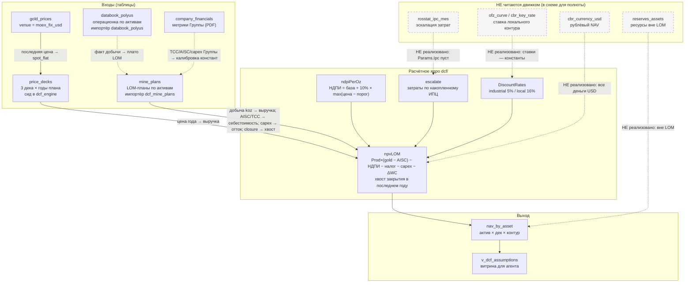

# Карта полноты данных DCF-контура (Полюс)

> **Что это.** Ответ на три вопроса: из чего состоит прогнозный движок, чем он заполнен сейчас (в процентах), и что заполнять первым. Документ ведётся вручную по публичным источникам; он не генерируется из БД, потому что половина пробелов — принципиально непубликуемые данные, которых SQL-запрос не покажет.
>
> **Чем не является.** Не заменяет `ARCHITECTURE.md` §6.2/§6.4 (источник истины по DDL и конвенциям) и не дублирует `docs/ROADMAP_DCF_POLYUS.md`. Отвечает только за полноту входов. Обновляется тем же PR, что меняет сид.
>
> **Актуально на:** 2026-10-11 (ночь: **пробел №9 закрыт в срезе 1** — ОПР-выпуск 2025–2027 приписан Сухому Логу, `mine_plans FINAL` = **90 строк**, приёмка — `docs/ROADMAP_DCF_POLYUS.md` §7.2; ранее тем же днём — сверка с применённым AISC-сидом, 87 строк, все 77 строк сида совпали с `polyus_lom_reconciled_long.csv`). Источники — Годовой обзор ПАО «Полюс» за 2025 год, презентация «Ключевые проекты роста» (декабрь 2024), пресс-релизы 4Q/FY 2018–2021 (per-asset AISC/TCC, §2/[^aisc]) и пресс-релиз за 1 полугодие 2026 (сноска 13 — атрибуция ОПР-руды, россыпь вне показателей производства).

---

## 1. Схема зависимостей движка

**Как читать:** сплошные стрелки — реализованный путь данных; пунктирные в блоке `НЕ читаются движком` — ряды, которые лежат в БД, но **в формулу NAV не входят**. Их наличие в схеме важно именно как перечень нереализованного: `rosstat_ipc_mes` не эскалирует затраты, `ofz_curve`/`cbr_key_rate` не задают локальную ставку (она константа 0.16), `cbr_currency_usd` не используется (все деньги USD), `reserves_assets` не участвует.

---

## 2. Карта покрытия по активам

Статусы: **факт** — опубликовано, источник со страницей; **derived** — выведено по публичной формуле; **assumption** — допущение с обоснованием; **missing** — нет.

Источники (сокращения): **ГО2025** — Годовой обзор ПАО «Полюс» за 2025 год; **ДЕК** — презентация «Ключевые проекты роста», декабрь 2024.

| Актив | `production_koz` | `grade_gpt` | `tcc` | `aisc` | `capex_sustaining` | `capex_project` | `closure_costs` |
|---|---|---|---|---|---|---|---|
| OLIMPIADA | факт (ГО2025, 926.5 koz) [^prod] | факт | факт (773) | derived [^aisc] | факт (450; 0 в AISC-сиде [^capex]) | assumption (0) | missing |
| BLAGODATNOYE | факт (434.0) [^prod] | факт | факт (691) | derived [^aisc] | факт (370; 0 в AISC-сиде [^capex]) | assumption (0) | missing |
| NATALKA | факт (567.4) [^prod] | факт | факт (671) | derived [^aisc] | факт (198; 0 в AISC-сиде [^capex]) | assumption (0) | missing |
| VERNINSKOYE2 | факт (271.7) [^prod] | факт | факт (735) | derived [^aisc] | факт (125; 0 в AISC-сиде [^capex]) | assumption (0) | missing |
| KURANAKH | факт (329.7) [^prod] | факт | факт (925) | derived [^aisc] | факт (362; 0 в AISC-сиде [^capex]) | assumption (0) | missing |
| TITIMUKHTA | **missing** (факт = 0) | факт | assumption (прокси БУ 773) | derived [^aisc] | **missing** | assumption (0) | missing |
| ZAPADNOYE | **missing** (ряда за 2025 нет) | факт | assumption (прокси БУ 671) | derived [^aisc] | **missing** | assumption (0) | missing |
| Sukhoi Log | факт (профиль 2 300–2 800, ДЕК) | факт (2.3–2.8 г/т) | assumption (прокси Иркутской БЕ 735) | derived [^aisc] | assumption (0) | assumption (6 000 итог, размазан) | missing |

### Покрытие по столбцам

| Столбец | Факт | Derived | Assumption | Missing | Доля фактических |
|---|---|---|---|---|---|
| `production_koz` | 6 | 0 | 0 | 2 | **6 / 8 = 75 %** |
| `grade_gpt` [^grade] | 8 | 0 | 0 | 0 | **8 / 8 = 100 %** |
| `tcc` | 5 | 0 | 3 | 0 | 5 / 8 = 63 % |
| `aisc` | 0 | 8 | 0 | 0 | 0 / 8 = 0 % |
| `capex_sustaining` | 5 | 0 | 0 | 3 | 5 / 8 = 63 % |
| `capex_project` | 0 | 0 | 8 | 0 | 0 / 8 = 0 % |
| `closure_costs` | 0 | 0 | 0 | 8 | **0 / 8 = 0 %** |

[^grade]: **`grade_gpt` — 100 % это ДОСТУПНОСТЬ В ИСТОЧНИКЕ, а не то, что лежит в таблице.** Содержание в `MinePlanYear` (структура `dcf/model.go`) отсутствует, поэтому сид `dcf_mine_plans` пишет в колонку `NULL` у КАЖДОЙ строки (`dcf/mine_plans_import.go` передаёт `nil` безусловно), а движок её не читает — в формулу NPV `grade_gpt` не входит. То есть по факту в `mine_plans` столбец пуст у всех восьми активов, и 100 % описывает только полноту публикации содержания (у OLIMPIADA, Благодатного и т. д. grade опубликован, у Сухого Лога — 2.3–2.8 г/т), которую сид пока не переносит. Ноль здесь означал бы измеренное «0 г/т»; `NULL` отличает «не раскрыто в модели» от нуля. Если `grade_gpt` когда-нибудь войдёт в NPV, сид обязан начать его писать — до тех пор строка таблицы говорит о источнике, а не о содержимом `mine_plans`.

[^prod]: **`production_koz` — числа в ячейках (ГО2025) и в таблице `mine_plans` взяты из разных источников, и это не противоречие.** Ячейка карты отвечает на вопрос «что опубликовано» (ГО2025: Олимпиада 926.5, Благодатное 434.0, Наталка 567.4, Вернинское 271.7, Куранах 329.7 koz), а физически в `mine_plans` лежит годовой факт из `databook_polyus` — но какой именно, зависит от писателя. Go-сид `dcf_mine_plans` читает метрику `Total refined gold output` (`data='ANNUAL'`) по точной дате `date = makeDate(year + 1, 1, 1)` (FY2024 → 2025-01-01, FY2025 → 2026-01-01). Числа **Олимпиада 1441.3, Благодатное 499.8, Наталка 454.0, Вернинское 230.8, Куранах 309.9 koz** — из **ручного AISC-сида** `sql/dcf_mine_plans_seed.sql` (цель `make dcf-aisc`), а не из текущего Go-сида: AISC-сид читает `Total Dore gold output` по `toYear(date) = year` (при `year = 2025` это наблюдение, датированное 2025-01-01, то есть FY2024) и перезаписывает те же ключи `(company, asset, year)`. Этот год — первый год плана, далее добыча идёт плато последнего известного факта. Расхождение между ГО2025 и датапаком по одному и тому же году (разные метрики выпуска) — известно и настоящим документом не разрешается. У Вернинского 2025–2028 `production_koz = 0`: карьер законсервирован с сентября 2024, ЗИФ перерабатывает руду Сухого Лога по ОПР (ГО2025, стр. 5, сноска 1; стр. 34–35), поэтому в окне консервации (`HALT_WINDOWS` в `scripts/models/polyus/aisc.py`) строки годов сохранены, но добыча нулевая, а плато 230.8 начинается с 2029-го. Окно задано по датапаку; по публикации ([«Проекты роста»](https://polyus.com/ru/investors/proekty-rosta/)) ОПР закрывается 2027-м — запуском первой линии ЗИФ Сухого Лога в 2028, то есть 2028-й в модели становится первым проектным годом Сухого Лога, а не ОПР-годом (см. пробел №9).

**Метрика `dore` против `refined` — названное расхождение, а не дефект этого документа.** 2025 год: сумма `refined` по пяти рудникам сходится с `CONSOLIDATED OPERATING RESULTS` РОВНО (2790.6 == 2790.6), а сумма `dore` даёт 2779.2 — разница 11.4 koz и есть ОПР-выпуск Вернинской ЗИФ. Текущий Go-сид читает `refined` (`actualProductionMetric` в `dcf/mine_plans_import.go`), а `dore` читает ручной AISC-сид `sql/dcf_mine_plans_seed.sql`, поэтому с применённым AISC-сидом сумма плана по активам (2947.2) расходится с публикацией на **5.61 %**: разницу создают Олимпиада (`dore` 1441.3 против `refined` 1265.7) и Вернинское, у которого ОПР-выпуск перенесён Сухому Логу, но остаётся в групповой сумме публикации. Переход всех пяти рудников на `refined` (включая ручной AISC-сид) — срез 2 модели выпуска; до тех пор расхождение объяснено по частям, а не замаскировано.

[^aisc]: **`aisc` — derived, но уже не единым клином.** Per-asset AISC и TCC Полюс публикует в пресс-релизах 4Q/FY **2018–2021**; с 2022 даёт поактивный TCC, но AISC — только групповой, поэтому за 2025+ значение выводится. Категория остаётся `derived` (измерения за поздние годы нет), но способ вывода изменился: клин `(AISC − TCC)` калибруется как **доля** от TCC за **2019–2021** по каждому активу (`r̄` ≈ 0.49–0.75) и экстраполируется на LOM скриптом `scripts/models/polyus/aisc.py` (цель `make dcf-aisc`), после чего увязывается к групповому AISC $1 437/oz. Прежний «TCC актива + $698» (один клин на все активы) заменён взвешенной структурой; увязка «точна» только на групповом уровне. Сухой Лог исключение: своего AISC не раскрывает, его строки остаются с плоским клином от Go-сида. **Сид применён 2026-10-11** (шаг `make ch-sql FILE=sql/dcf_mine_plans_seed.sql` + перепрогон `dcf_engine`, приёмка — ROADMAP §7.1): в `mine_plans FINAL` 87 строк = 77 AISC-сида + 10 строк Сухого Лога 2028–2037 от Go-сида (позже тем же днём до 90 строк добавились ОПР-строки Сухого Лога 2025–2027 — §7.2); множитель увязки `m` ≈ 1.9923, остаток 0.0 USD/oz, сверка всех 77 строк с `polyus_lom_reconciled_long.csv` расхождений не дала. Нюанс увязки: взвешенный TCC 2025-го в сиде — **758.14, а не 739.0** (групповой якорь), потому что Вернинское в окне консервации входит в увязку с нулевым весом и выпадает из среднего; на точность увязки AISC это не влияет — целью является групповой AISC, не TCC.

[^capex]: **`capex_sustaining` в калиброванном AISC-сиде равен 0, у пяти рудников.** Первое число в ячейке — опубликованный capex (его пишет Go-сид `dcf_mine_plans`). В `sql/dcf_mine_plans_seed.sql` (ручной шаг `make dcf-aisc`) `capex_sustaining = 0`, потому что поддержание **уже внутри** `aisc` (Полюс определяет AISC как «TCC plus sustaining capital expenditures»), а `npvLOM` вычитает и `aisc`, и `capex_sustaining` — ненулевое значение удвоило бы отток. Клин для глазной сверки лежит в CSV (`wedge_usd_per_oz`, `wedge_mn_usd`), НЕ в оттоке модели.

### Покрытие по активам

| Актив | Фактических столбцов из 7 | Полностью обеспечен? |
|---|---|---|
| OLIMPIADA | 4 | нет (aisc derived, capex_project assumption, closure missing) |
| BLAGODATNOYE | 4 | нет |
| NATALKA | 4 | нет |
| VERNINSKOYE2 | 4 | нет |
| KURANAKH | 4 | нет |
| TITIMUKHTA | 1 | нет (только grade; добыча, TCC, capex — не факт) |
| ZAPADNOYE | 1 | нет (только grade) |
| Sukhoi Log | 2 | нет (только добыча и grade) |

**Ни один актив не обеспечен полностью; максимум — 4 факта из 7 (у пяти действующих рудников).** Доля фактических входов по всем ячейкам: 24 из 56 = **43 %** (сумма столбца «Факт» из таблицы выше: 6+8+5+0+5+0+0).

> **Что означает этот процент.** Это доля **заполненных входов**, а не точность NAV. Столбец `closure_costs` пуст у всех восьми — это ноль процентов покрытия при относительно малом влиянии на NPV (провижен Группы $75 млн против сотен миллионов годового потока). Столбец `aisc` заполнен у всех восьми на 100 %, но целиком через `derived`. Поэтому «43 % покрытия» ≠ «NAV верен наполовину»: часть пробелов меняет NAV на доли процента, а пропуск `production_koz` у двух активов убирает их из расчёта целиком.

---

## 3. Приоритизированный список пробелов

Приоритет — по влиянию на NAV и по тому, насколько молчаливо дефект проявляется.

| # | Пробел | Почему в этом месте | Влияние на NAV | Что нужно, чтобы закрыть |
|---|---|---|---|---|
| **1** | **Налоговый режим Сухого Лога (РИП)** | С 01.01.2024 Сухой Лог в реестре региональных инвестиционных проектов: льготный налог на прибыль **10 %** против базовых 25 %, льготная НДПИ; график льгот — до 2039 (ДЕК, слайд 24). Модель считает его **той же формулой**, что и действующие рудники (`ProfitTaxPct`, `ndpiPerOz` — общие) | **Прямое и систематическое**: крупнейший проект портфеля (43.3 Moz) облагается по неверной ставке, а его горизонт уходит в 2030-е, где эффект максимален | Отдельный пункт роадмапа: ставки по активу, а не по модели. Менять `ndpiPerOz`/`ProfitTaxPct` на per-asset конфигурацию |
| **2** | **AISC по активам публикуется только за 2018–2021** | Polyus раскрывает per-asset AISC и TCC в пресс-релизах 4Q/FY — ряд доступен за **2018–2021**. Начиная с 2022 отчётность перешла на полугодовой формат и даёт поактивный **TCC**, но AISC — **только групповой**. Поэтому за 2025+ AISC актива по-прежнему выводится: клин поддержания `(AISC − TCC)` откалиброван как доля от TCC за **2019–2021** и экстраполирован на LOM (`scripts/models/polyus/aisc.py`, цель `make dcf-aisc`), затем увязан к групповому AISC $1 437/oz | **Среднее, но по каждому активу сразу**: теперь клин у каждого рудника свой (доля `r̄` ≈ 0.49–0.75 против единого «TCC + 698»), то есть структура затрат наблюдённая, а не плоская; однако поздние годы — экстраполяция с ранних, и увязка «точна» только на групповом уровне | **Закрыт для 2019–2021** (ряд per-asset AISC/TCC найден и разобран). Для 2022+ источника нет: отчётность полугодовая, per-asset AISC не публикуется. Снижать погрешность поздних лет можно отраслевыми бенчмарками — вне текущих источников. Сид **применён вручную 2026-10-11** (87 строк в `mine_plans FINAL` на тот момент; сейчас 90 — добавлены ОПР-строки Сухого Лога, §7.2 роадмапа; расчёт перепрогнан — приёмка `docs/ROADMAP_DCF_POLYUS.md` §7.1). Остаток — автоматическая доставка сида (пока ручной шаг, см. там же) |
| **3** | **База и порог НДПИ в модели** | `defaultParams`: `NdpiBaseUSDPerOz = 0`, `NdpiThresholdUSD = 1900`. Публично с 01.01.2025: **базовая ставка НДПИ 6 %** и надбавка 10 % от превышения LBMA над **$1 897**/oz (ГО2025) | **Прямое и на весь портфель**: нулевая база занижает НДПИ по каждому активу и году; порог 1900 против 1897 — малая, но систематическая разница | Отдельный пункт роадмапа: вынести базовую ставку НДПИ в `Params`, сверить порог с публикацией |
| **4** | **Capex без split sustaining/project** | Публикация даёт capex по бизнес-юнитам, но не делит на поддержание и развитие. Вся сумма уходит в `capex_sustaining`, `capex_project = 0` (у Сухого Лога наоборот — итог проекта в `capex_project`) | **Среднее**: при непрерывном поддержании это ближе к истине, чем кажется, но у активов в стадии расширения (Благодатное, Куранах) недооценивается развитие и искажается срок окупаемости | Нет публичного split. Можно разделить по описаниям проектов (Mill 5, расширение ЗИФ) — экспертная оценка, отдельный пункт |
| **5** | **По-годичный профиль добычи для действующих рудников** | Публикуется срок службы по MOPs и 10-летние средние по проектам роста, но **не по-годичный график** добычи. Сейчас — плато последним фактом на весь срок; исключение — известные окна простоя, заданные данными (`HALT_WINDOWS` в скрипте AISC-сида, первый случай — консервация карьера Вернинского 2025–2028, см. пробел №9) | **Среднее**: форма потока влияет на дисконт, а год хвоста закрытия задаётся последним годом плана. Плато систематически не даёт падения добычи в хвосте | Нет публичного источника. Парсинг техотчётов/JORC при их появлении — отдельный пункт |
| **6** | **Closure по активам** | Публикуется только групповой провижен ($75 млн non-current на 31.12.2024). Per-asset нет. В сиде `closure_costs = 0` у всех — это означает «не задано», а **не** «закрытие бесплатно» | **Малое по величине**, но обязательное по смыслу: хвост закрытия — единственная отрицательная терминальная стоимость, и его отсутствие слегка завышает каждый NPV | Распределить групповой провижен по активам (пропорционально запасам или добыче) — допущение, требующее решения владельца |
| **7** | **Форма ценовой кривой деков** | Формы нет в публичных источниках: цена задана плоско на все годы по трём якорям (`spot_flat` — последний MOEX-фикс, `consensus_lt` $3 000, `own_scenario` $4 600) | **Сильное по дисконту, но непринципиальное по честности**: плоскость — явное допущение, а не неверные данные. Форма кривой — отдельный пункт, когда появится содержательный вход | Нет публичного источника формы. Собственный сценарий (§6.4) — единственный кандидат |
| **8** | **Три разных пробела выпуска слиты в один: россыпь + два отработанных рудника** | Формулировка «`TITIMUKHTA` и `ZAPADNOYE` дают ноль, потому что их выпуск учтён таблицей `ALLUVIALS`» **проверкой 2026-10-11 опровергнута**. Факты: (а) у `ALLUVIALS` есть ПРЯМАЯ метрика выпуска `Refined gold production` — **129.9 koz (2023), 103.3 koz (2024)** — и она не ноль; сид её просто не читает по имени; (б) `TITIMUKHTA` (2016: `ore mined` 3225 kt, `dore` 103.1 koz) и `ZAPADNOYE` (2010: 750 kt, 27.9 koz) — **отработанные рудники**, обнулившиеся к 2021 и 2013 независимо от россыпи. Правило «нет пригодного факта — не пишем строку» верно, но им склеены три разные сущности | **Среднее по сумме, молчаливое по проявлению**: россыпные 129.9/103.3 koz за 2023/2024 выпадают из NAV (в порядке величины — как Благодатное), причём именно ими объясняется невязка группового баланса 2023 (`CONSOLIDATED` 2457.6 против суммы рудников 2327.7 — разница ровно 129.9). Титимухта и Западное из NAV выпадать и должны (отработаны) | Решение: россыпь 2023–2024 восстанавливать **прямой метрикой `Refined gold production`**, а не формулой `Sands×grade` (та даёт 130.1/104.2 — отклонение 1.5 %, то есть подменила бы измерение расчётом); Титимухта и Западное в карте переквалифицировать из «missing добыча» в «актив отработан». Отдельный пункт роадмапа — [docs/plans/POLYUS_OUTPUT_MODEL_PLAN.md](plans/POLYUS_OUTPUT_MODEL_PLAN.md) §6.1 |
| **9** | **Атрибуция выплавки Вернинской ЗИФ из руды Сухого Лога (ОПР, 2025–2027) — ✅ ЗАКРЫТ 2026-10-11 (срез 1)** | Карьер Вернинского законсервирован с сентября 2024, но компания ведёт горно-подготовительные работы на карьере Сухого Лога и накапливает руду для переработки на Вернинской ЗИФ (ГО2025, стр. 5, сноска 1; стр. 34–35). AISC-сид обнуляет `production_koz` Вернинского в окне консервации 2025–2028, при этом измеренная выплавка в `databook_polyus` есть (242.2 koz `refined` в 2025) — это руда Сухого Лога, поэтому добыча **не входила в NAV ни одного актива**: ни у Вернинского (обнулено), ни у Сухого Лога (его строки Go-сида начинались с 2028) | **Среднее по сумме и молчаливое по проявлению**: ~242–272 koz/год реальной выплавки три года подряд (порядок величины — как Благодатное) были вне портфеля; прогон был успешен, пропажу видел только контроль сида с датапаком | **Закрыто** скриптом `scripts/models/polyus/polyus_output_model.py` (цель `make polyus-output`, сид `sql/polyus_output_seed.sql`): три строки Сухого Лога 2025–2027 (242.2 / 271.7 / 257.0 koz) при `tcc = aisc = 735`, `capex`/`closure` нули. Набор ключей не пересекается с Go-сидом (2028–2037) и AISC-сидом (пять рудников) — `ReplacingMergeTree` сворачивает строку целиком, поэтому проверка стоит в коде (`assert_no_overlap`). Приёмка — `docs/ROADMAP_DCF_POLYUS.md` §7.2; **остаток**: метрика `refined` для пяти рудников, окно ОПР как функция сценария запуска, сдвиг дисконта в `npvLOM` |
| **10** | **Профиль Сухого Лога в сиде: полная мощность обеих линий с 2028 — оптимистичнее всех источников** | `mine_plans` по Сухому Логу даёт 2 300–2 800 koz каждый год с 2028 (проверено в БД), тогда как проект запускается **двумя линиями** (официально 2028 и 2029 — [«Проекты роста»](https://polyus.com/ru/investors/proekty-rosta/); по консенсусу 2030 и 2031–2032). То есть сид ставит первую линию на 2 года раньше плана, вторую — одновременно с первой, и не имеет ступенчатого выхода на мощность | **Крупнейший единичный эффект точности в модели**: Сухой Лог даёт **54 887,4 млн USD = 45,5 % суммарного NAV**; весь проектный поток начинается раньше и сразу полный, то есть NAV систематически завышен | Запланировано отдельным пунктом: дата запуска — параметр сценария (базовый — консенсус 2030/2031–2032, второй — план 2028/2029), профиль ступенчатый и задан данными. Мониторинг нового официального плана — триггеры `polyus_ir` в `events_calendar` (обновлённое ТЭО, ожидается конец 2026). См. [docs/plans/POLYUS_OUTPUT_MODEL_PLAN.md](plans/POLYUS_OUTPUT_MODEL_PLAN.md) §6.3 |

**Дополнительно:**

- Россыпной пробел (строка **8** выше) — проверкой 2026-10-11 переформулирован: под «россыпью» были слиты три разные сущности (россыпной блок с прямой метрикой выпуска 129.9/103.3 koz за 2023/2024, отработанная Титимухта, отработанное Западное). Причина, по которой `mine_plans` покрывает 6 активов из 8, остаётся, но теперь у неё два разных объяснения: два рудника отработаны (и это норма), а россыпь закрыта с 2025 (и её история восстанавливается прямой метрикой, а не формулой).
- **Чульбаткан и Чертово Корыто не входят в сид.** Данные собраны (запуск 2029, 0.3 и 0.3–0.4 млн унц/год, capex $0.6–0.8 млрд и ~$1.0 млрд) — это следующий пункт после текущего.

---

## 4. Правило приёмки

Гард `checkYearCoverage` (`dcf/coverage.go`) проверяет: **у каждого года каждого плана обязана быть цена в каждом каноническом деке**. Частичное покрытие — предупреждение с перечнем непокрытых пар `актив:год`; полное отсутствие пересечения — ошибка, потому что тогда все годы пропускаются и `nav_by_asset` получает нулевой NPV при непустых `mine_plans`.

Это же правило — причина, по которой сид `price_decks` пишет цену на **все** годы плана, а не на текущий год: одногодичный дек обнулял бы план за пределами первого года, а на единственном году пересечения ещё и делал бы оба контура ставки неразличимыми (`1/(1+rate)^0 = 1`).
