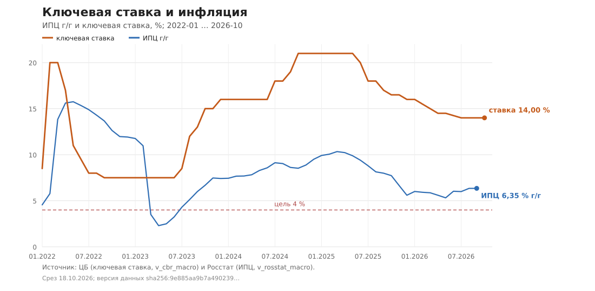
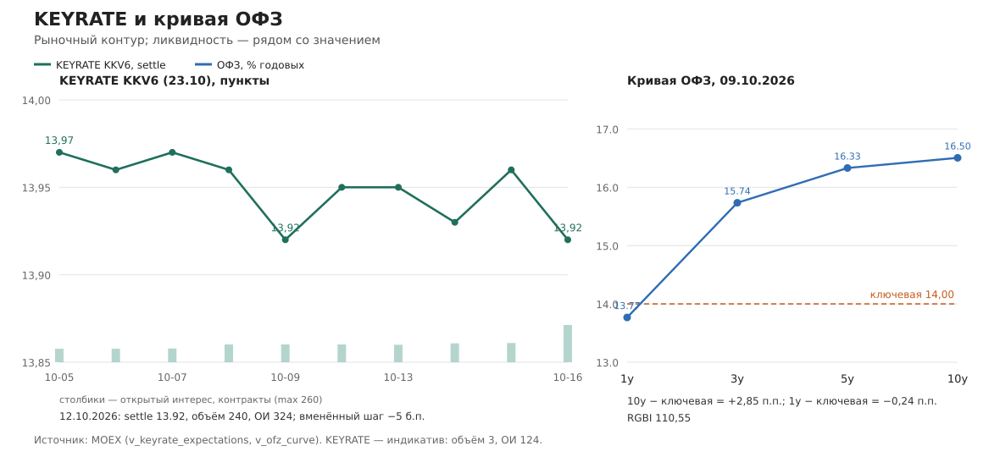
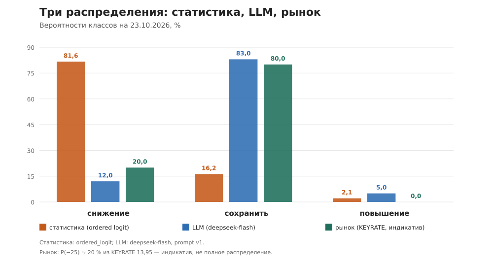

# Ставка 14 %: статистика видит снижение, рынок и LLM — паузу

## Прогноз на 23 октября 2026: снизить — 81,65 %, сохранить — 16,24 %, повысить — 2,12 % (срез 18.10.2026)

Это первая публикация контура прогноза ключевой ставки. Мы публикуем не мнение, а распределение вероятностей и условия, при которых его придётся пересмотреть. Каждое число ниже имеет дату и источник; устаревшие входы названы «нет обновления», а не заменены последним известным значением. Текст — не инвестиционная рекомендация.

---

## 1. Короткий вывод

Формальный прогноз контура на заседание **23.10.2026** — **снижение**: вероятность класса «снизить» **81,65 %**, «сохранить» — **16,24 %**, «повысить» — **2,12 %**. Ожидаемый шаг статистической модели — **−63,36 б.п.**, правило Тейлора даёт **−65,15 б.п.**[^stat]

Но два независимых трека говорят другое. LLM-трек (`deepseek-flash`) даёт **12 / 83 / 5 %** в пользу сохранения и ожидаемый шаг **−5 б.п.** (ставка **13,95 %**).[^llm] Рынок KEYRATE на 12.10.2026 стоит на **13,95** по серии к 23.10 — это **−5 б.п.**, открытый интерес **124** контракта, дневной объём **3**.[^keyrate] Иными словами, статистика видит снижение, а LLM и рынок — паузу.

ML-трек не голосует по ставке: он даёт nowcast инфляции. Октябрьский ИПЦ по недельной модели v1 — **0,805 / 0,819 % м/м** (direct / bottom-up), по месячной v2 (short-sample, 155 месяцев) — **0,4648 / 0,5522 / 0,5937 / 0,6156 % м/м** (direct / bottom-up / direct с МП / bottom-up с МП); бенчмарк «последнее значение» — **0,350 % м/м**.[^ml] Это инфляция выше цели 4 %, а не аргумент за агрессивное снижение.

Мы не усредняем треки и не выбираем удобный. Ниже — что показали данные, почему расхождение возникло и какие пороги заставят нас переписать прогноз.

---

## 2. Что произошло с данными

Предыдущей публикации у контура нет: это первый выпуск. База сравнения — заседание **11.09.2026** и резюме ЦБ, опубликованное **23.09.2026**: ставка сохранена на **14,00 %** (уровень держится с 24.07.2026), сигнала о направленности дальнейших шагов не дано; в тексте — «значительные проинфляционные риски и неопределённость».[^cbr]

### 2.1. Цены

Сентябрьский ИПЦ — **+0,35 % м/м** после **−0,08 % м/м** в августе; годовой темп — **6,35 %** (август: 6,34 %). Внутри сентября: продовольствие **0,00 %**, непродовольственные товары **+0,55 %**, услуги **+0,58 %**.[^rosstat]

Недельные данные за **05.10.2026** показывают ускорение: медиана недельного прироста по **111** товарным рядам — **+0,19 %** против **+0,03 %** на 14.09 и 21.09; доля подорожавших позиций — **72,1 %** против **54,1 %** в середине сентября. Публикации за 12.10 в БД нет — **нет обновления**.[^weekly]

Базовая инфляция (базовый ИПЦ ЦБ) — **+0,49 % м/м** в августе после **+0,56 %** в июле; простая годовая экстраполяция даёт около **6,0 %**. За сентябрь ряда нет — **нет обновления**.[^base]

*Рис. 1. Ключевая ставка и ИПЦ г/г, 2022-01 … 2026-10. Источник: ЦБ (`v_cbr_macro`) и Росстат (`v_rosstat_macro`).*

### 2.2. Ожидания и предприятия

Инфляционные ожидания населения в сентябре выросли: ожидаемая инфляция — **14,2 %** (август: 13,7 %), наблюдаемая — **15,1 %** (август: 14,3 %).[^expect]

Мониторинг предприятий ЦБ за август: ценовые ожидания бизнеса SA — **22,66** балансовых пункта, ИБК SA — **−2,26**. За июль: загрузка мощностей SA — **77,0 %**, обеспеченность персоналом SA — **−19,7** (дефицит кадров сохраняется).[^survey]

### 2.3. Труд, кредит, деньги

Безработица — **2,3 %** в июле (июнь: 2,2 %; за август — **нет обновления**); номинальная зарплата — **109 524 ₽** в августе, **+10,29 % г/г**, реальная (дефлятор — ИПЦ августа 6,34 %) — около **+3,71 %**.[^labor]

Кредит экономике — **167,29 трлн ₽** на 01.09.2026, **+10,39 % г/г**. Ставки по кредитам юрлицам в августе: до 1 года включительно «до востребования» — **17,88 %**, 181 день — 1 год — **15,64 %**, 1–3 года — **12,59 %**, свыше 1 года — **12,98 %**. Короткий кредит стоит на **3,88 п.п.** выше ключевой ставки.[^credit]

Денежная масса М2 — **137,07 трлн ₽** на 01.09.2026, **+12,76 % г/г**.[^m2]

### 2.4. Бюджет, внешние условия, сбережения

Федеральный бюджет в августе (месячное исполнение): доходы **3 793,7 млрд ₽**, расходы **3 187,5 млрд ₽**, профицит **+606,2 млрд ₽**. Кумулятивный дефицит января–июня — **−371,9 млрд ₽**; данные за июль–август не загружены — **нет обновления**.[^budget]

Курс ЦБ: **83,9153 ₽/долл.** на 13.10.2026 против **85,4173** на 09.10 — рубль за неделю укрепился примерно на **1,8 %**. Золото — **11 294,38 ₽/г**. Ряда Brent в БД нет — **нет обновления**.[^fx]

Депозиты населения — **68,14 трлн ₽** на 01.09.2026 (**+9,30 % г/г**), организаций — **59,34 трлн ₽** (**+14,62 % г/г**).[^deposits]

ВВП во II квартале 2026 — **+1,31 % г/г** (I квартал: +0,95 %). Числового ряда разрыва выпуска ЦБ не публикует; прокси — ИБК и загрузка мощностей — остаются слабыми.[^gdp]

---

## 3. Карта каналов

Каналы названы так, как их называет сам ЦБ в резюме; вес — качественная оценка по [KEY_RATE_CHANNELS.md](../KEY_RATE_CHANNELS.md) §3, а не позиция Банка России. Устаревшие входы помечены «нет обновления».

| Канал | Что видно на 18.10.2026 | Направление | Дата и источник |
|---|---|---|---|
| **Текущий рост цен** | ИПЦ сентябрь **+0,35 % м/м**, **6,35 % г/г**; недельная медиана **+0,19 %** н/н, доля подорожавших **72,1 %** | проинфляционное | 30.09 / 05.10; Росстат, `v_rosstat_macro`[^rosstat] |
| **Устойчивая («базовая») инфляция** | Базовый ИПЦ август **+0,49 % м/м** (~6,0 % в годовом выражении по простой экстраполяции); за сентябрь — **нет обновления** | проинфляционное | 31.08; ЦБ, `v_cbr_macro`[^base] |
| **Инфляционные и ценовые ожидания** | Ожидаемая **14,2 %**, наблюдаемая **15,1 %** (сентябрь); ценовые ожидания бизнеса SA **22,66** (август) | проинфляционное | 14.09 / 01.08; ЦБ[^expect] [^survey] |
| **Рынок труда** | Безработица **2,3 %** (июль); номинальная зарплата **+10,29 % г/г** (август), реальная ~**+3,71 %**; обеспеченность персоналом SA **−19,7** (июль) | проинфляционное | 31.07 / 01.08; Росстат, ЦБ[^labor] [^survey] |
| **Кредитование и трансмиссия ДКП** | Кредит экономике **+10,39 % г/г** (сентябрь); короткий кредит юрлицам **17,88 %** — на **3,88 п.п.** выше ключевой; длинный — **12,59–12,98 %** | смешанное: высокие ставки ужесточают, но рост портфеля ещё высок | 01.09 / 30.08; ЦБ[^credit] |
| **Разрыв выпуска / перегрев спроса** | ВВП II кв. **+1,31 % г/г**; ИБК SA **−2,26** (август); загрузка мощностей **77,0 %** (июль); числового разрыва выпуска нет | нейтральное / смешанное | 01.07 / 01.08; Росстат, ЦБ[^gdp] [^survey] |
| **Бюджетный импульс** | Август (месячно): профицит **+606,2 млрд ₽**; кумулятивный дефицит января–июня **−371,9 млрд ₽**; июль–август — **нет обновления** | проинфляционный риск | 01.08 / 01.06; Минфин, `v_minfin_budget`[^budget] |
| **Денежная масса** | М2 **137,07 трлн ₽**, **+12,76 % г/г** (сентябрь) | проинфляционное | 01.09; ЦБ[^m2] |
| **Внешние условия и курс** | USD **83,92 ₽** (13.10) против **85,42** (09.10) — рубль крепче; золото **11 294 ₽/г**; Brent — **нет обновления** | дезинфляционное через курс; нефть не читается | 13.10; ЦБ[^fx] |
| **Сберегательное поведение** | Депозиты населения **68,14 трлн ₽** (**+9,30 % г/г**), организаций **59,34 трлн ₽** (**+14,62 % г/г**) | дезинфляционное (высокая норма сбережения) | 01.09; ЦБ[^deposits] |
| **Автономные (немонетарные) факторы** | Макропруденциальные меры и структурный дефицит ликвидности; RUONIA **13,91 %** против ключевой **14,00 %** (спред **−9 б.п.**), объём **618,8 млрд ₽** | качественно, без числового ряда | 14.10; ЦБ[^ruonia] |

**Что читается иначе.** Статистическая модель смотрит прежде всего на **уровень реальной ставки**: 14,00 % минус 6,35 % = **+7,65 п.п.**, и на замедление инфляции с 15,75 % в мае 2022 до 6,35 % сейчас. LLM и рынок смотрят на **функцию реакции ЦБ**: инфляция всё ещё выше цели, ожидания в сентябре выросли, бюджетный импульс остаётся риском, кредит растёт на 10,4 %, рынок труда жёсткий, а сентябрьское резюме прямо говорит о значительных проинфляционных рисках и не даёт сигнала. Это не «рынок ошибается» и не «модель ошибается» — это разные вопросы: «какую ставку описывает историческое правило» и «что сделает ЦБ в текущем режиме».

---

## 4. Рыночный контур

| Инструмент | Значение | Ликвидность | Дата |
|---|---|---|---|
| KEYRATE KKV6 (заседание 23.10) | settle **13,95**, вменённый шаг **−5 б.п.** | объём **3**, ОИ **124** | 12.10.2026[^keyrate] |
| KEYRATE KKZ6 (заседание 18.12) | settle **13,86**, вменённый шаг **−14 б.п.** | объём **0**, ОИ **30** | 12.10.2026[^keyrate] |
| KEYRATE KKG7 (февраль 2027) | settle **15,97** | объём **0**, ОИ **0** — **не ожидание**, индикатив | 12.10.2026[^keyrate] |
| ОФЗ 1y / 3y / 5y / 10y | **13,76 / 15,97 / 16,57 / 16,85 %** | снимок, истории нет | 09.10.2026[^ofz] |
| RGBI | **110,55** | — | 09.10.2026[^ofz] |
| RUONIA | **13,91 %** (p25 **13,75**, p75 **13,95**) | объём **618,8 млрд ₽** | 14.10.2026[^ruonia] |

Ближайшее заседание — **23.10.2026** (13:30 МСК), следующее — **18.12.2026**; обе даты есть в календаре контура.[^calendar]

Что это значит. Ближайшая серия KEYRATE стоит на **5 б.п. ниже** ключевой — рынок скорее ждёт паузу, чем снижение. Разница между сериями 23.10 и 18.12 — **−9 б.п.**: даже к декабрю рынок закладывает очень осторожное смягчение. Кривая ОФЗ **выше** ключевой на всём горизонте от 3 до 10 лет: 10-летняя доходность **16,85 %** — это **+2,85 п.п.** к ключевой и около **+10,50 п.п.** к текущему ИПЦ г/г. RUONIA стоит практически на ключевой (**−9 б.п.**), объём приличный — признаков резкого дефицита ликвидности в этом срезе нет.

Оговорка по ликвидности обязательна: у KKV6 объём **3** контракта и ОИ **124**, у KKZ6 — **0** и **30**. Это **индикатив**, а не полноценное рыночное распределение; у серии KKG7 сделок и открытого интереса нет вовсе, поэтому её **15,97** мы не читаем как ожидание ставки в феврале 2027.

*Рис. 2. Слева — KEYRATE KKV6 (settle и открытый интерес); справа — кривая ОФЗ 09.10.2026 и ключевая ставка. Источник: MOEX (`v_keyrate_expectations`, `v_ofz_curve`).*

### 4.1. Консенсус и среднесрочный прогноз ЦБ

Макроопрос ЦБ на **01.09.2026**: средняя ключевая ставка 2026 — медиана **14,5 %** (диапазон 14,3–14,6), 2027 — **12,43 %** (9,75–13,5), 2028 — **10,0 %**, 2029 — **8,56 %**; нейтральная ставка — медиана **8,0 %**. По 2026 году — 32 ответа.[^consensus]

Среднесрочный прогноз ЦБ (выпуск **05.08.2026**, к заседанию 24.07.2026): средняя ключевая ставка **14,5–14,6 %** в 2026, **10,5–12,5 %** в 2027, **8,0–9,0 %** в 2028, **7,5–8,5 %** в 2029; ИПЦ в среднем за 2026 — **5,9–6,2 %**, декабрь к декабрю — **6,0–7,0 %**; декабрь к декабрю 2027–2029 — **4,0 %**. Это не прогноз нашего контура, а референс, с которым сверяется наша траектория; на опорном заседании 23.10.2026 ЦБ обновит эти диапазоны.[^mt]

---

## 5. Расхождение контуров: что именно читается иначе

**Статистика.** Упорядоченная логит на **108** решениях ЦБ (2014-02-14 … 2026-09-11) даёт **81,65 %** за снижение. Модель обучена на историческом отображении «данные → класс решения»; в её признаках — ставка до заседания, сезонно сглаженная инфляция и разрыв выпуска. Она не знает ни сентябрьского сигнала «не давать сигнала», ни бюджетного импульса, ни всплеска ожиданий: это не её информационное множество. Плюс известная оговорка: на скользящем окне 40 правило Тейлора существенно хуже наивных бенчмарков (RMSE **464,57 б.п.** против **164,38** у B1), поэтому **−65 б.п.** Тейлора — это линейная экстраполяция, а не доказательство, что ЦБ снизит на 65 б.п.[^stat]

**LLM.** `deepseek-flash` читает тот же снимок, но отвечает на вопрос «что сделает ЦБ»: **83 %** за сохранение. В обосновании — высокая инфляция, проинфляционные риски бюджета и кредита, рост ожиданий, пауза 11.09 без сигнала и осторожная рыночная траектория; бюджетный импульс остаётся риском (кумулятивный дефицит января–июня −0,37 трлн ₽, июль–август — нет обновления). Разброс между тремя прогонами модели — **5 / 5 / 0 п.п.** по вероятностям и **5 б.п.** по ожидаемому шагу; это не «железные 83 %», а устойчивое смещение к паузе.[^llm] [^budget]

**Рынок.** KEYRATE и ОФЗ дают тот же ответ: **−5 б.п.** по ближайшей серии и кривая выше ключевой. Рынок не ждёт агрессивного снижения; он ждёт паузу с возможным осторожным смягчением позже.

**Какой канал читается иначе.** Статистика читает **реальную ставку и дезинфляцию** как достаточное условие для снижения. LLM и рынок читают **реакцию ЦБ на уровень инфляции, ожидания и бюджет** как недостаточное условие для снижения. Наш формальный прогноз — статистический, потому что это единственный трек, который даёт распределение вероятностей, проверяемое по истории (Brier/log loss в отчёте модели); но мы публикуем расхождение, а не прячем его. **Превосходство над рынком или консенсусом не заявляем**: значимого теста (Diebold–Mariano / encompassing) у нас нет.

---

## 6. Пороги, при которых прогноз изменится

Пороги сформулированы числом и условием — не «ухудшение фона».

| Что наблюдаем | Порог | Что меняем |
|---|---|---|
| Медиана недельного прироста цен | **≥ +0,20 % н/н две недели подряд** (сейчас +0,19 % на 05.10) | снижаем вероятность снижения; при **≥ +0,25 %** базовым становится «сохранить» |
| ИПЦ за октябрь (выход в середине ноября) | **≥ 0,60 % м/м** → пауза; **≤ 0,30 % м/м** → снижение остаётся базовым | пересчёт распределения статистики |
| Ожидаемая инфляция (следующий выпуск) | **≥ 15,0 %** (сейчас 14,2 %) → меньше пространства для снижения; **≤ 13,5 %** → больше | сдвиг вероятностей в сторону снижения/паузы |
| KEYRATE KKV6 | **≤ 13,90** (рынок закладывает ≥10 б.п. снижения) → рынок присоединяется к снижению; **≥ 14,00** → рынок за паузу/повышение | сверка рыночного контура |
| Кредит экономике | **≥ 12 % г/г** (сейчас 10,39 %) или ускорение месячного темпа **> 1 п.п.** | проинфляционный довод, меньше пространства для снижения |
| Базовая инфляция, среднее м/м за 3 месяца | **≥ 0,40 %** (июнь–август: 0,493 %) → пауза; **≤ 0,30 %** два месяца → снижение | пересчёт базового сценария |
| Кумулятивный дефицит бюджета января–августа | глубже **−1,0 трлн ₽** (январь–июнь: −0,372 трлн ₽; июль–август — нет обновления) | проинфляционный риск, меньше пространства для снижения |

Это авторские пороги контура, а не пороги ЦБ. Они фиксируются до события, чтобы после заседания нельзя было сказать «мы имели в виду другое».

---

## 7. Сценарии и вероятности

### 7.1. Три трека

| Сценарий | Статистика (`ordered_logit`) | LLM (`deepseek-flash`) | Рынок KEYRATE (индикатив) |
|---|---:|---:|---:|
| Снижение | **81,65 %** | **12 %** | **~20 %** (на 25 б.п.) |
| Сохранить | **16,24 %** | **83 %** | **~80 %** |
| Повышение | **2,12 %** | **5 %** | **~0 %** |
| Ожидаемый шаг | **−63,36 б.п.** | **−5 б.п.** | **−5 б.п.** |

Вероятности статистики в сумме дают **100,00 %**; в таблице округление до сотых даёт 100,01 % — это эффект округления, а не нормировочная ошибка. Рыночная строка — **не полное распределение**: из одного числа KEYRATE можно оценить только P(−25 б.п.) ≈ (14,00 − 13,95) / 0,25 = **20 %**; остаток мы условно относим к паузе, повышение из этой цены не читается. Поэтому рыночная строка помечена «индикатив».

*Рис. 3. Вероятности классов на 23.10.2026: статистика, LLM и индикатив KEYRATE. Источники: артефакты 18.10.2026 и `v_keyrate_expectations`.*

**Что такое E[step] = −63,36 б.п.** Это сумма исторических средних шагов классов, взвешенных вероятностями классов, а не обещание снизить ставку на 63 б.п. В выборке 108 решений — **39 снижений** со средним шагом **−80,13 б.п.**, **21 повышение** со средним **+120,24 б.п.** и **48 сохранений**; при вероятности снижения 81,65 % вклад класса даёт около −63 б.п. Это описание распределения, а не точечный приказ. Формулировка «модель относит заседание к классу с вероятностью p» — единственная корректная.

### 7.2. ML-трек: инфляционный вход, не голос по ставке

| Прогон | Октябрь 2026, % м/м | B1 «последнее значение» | Выборка / окно |
|---|---:|---:|---|
| v1 `catboost_direct` | **0,805** | 0,350 | 57 месяцев; недельное окно **1 из 4** |
| v1 `catboost_bottomup` | **0,819** | 0,350 | 57 месяцев; окно **1 из 4** |
| v2 short-sample `catboost_direct` | **0,4648** | 0,350 | 155 месяцев; live nowcast |
| v2 short-sample `catboost_bottomup` | **0,5522** | 0,350 | 155 месяцев; live nowcast |
| v2 short-sample `catboost_direct_mp` | **0,5937** | 0,350 | 155 месяцев; МП за август 2026 |
| v2 short-sample `catboost_bottomup_mp` | **0,6156** | 0,350 | 155 месяцев; МП за август 2026 |

ML-трек предсказывает **инфляцию**, а не ставку; распределения по ставке у него нет. Композитного `ordered_logit_ml` в этой сборке **нет** — мы не подставляем ML в таблицу вероятностей и не усредняем его с логитом. Числа v2 в таблице — **short-sample live nowcast** (155 месяцев); МП за август 2026 лежит на месяц глубже бэктеста. Long-sample-ревизия (292 месяца) используется **только для strict parity #190** и в live-nowcast не подставляется. PR #177 ещё не смержен; публикация ждёт мержа #177 (выбор владельца). Окно v1 частичное (1 из 4 недель), поэтому v1 и v2 — два разных среза, а не «одна модель в двух видах».[^ml]

### 7.3. Что это значит для решения

Если реализуется статистический сценарий, ЦБ снизит ставку 23.10 — и тогда LLM и рынок ошиблись. Если реализуется сценарий LLM/рынка, ошиблась статистика, и это будет видно по журналу. Мы публикуем оба, потому что честный трек важнее красивого одного числа. Пост-апдейт после заседания — отдельный шаг, в этом тексте его нет.

---

## 8. Что записано в журнал

**Статус: строки записаны в dev-ClickHouse** (PR #196). В рабочем контуре записи пока нет: нужен мерж #196 и перезапуск ingest, чтобы `EnsureTables` применил миграцию `error_bp`. Публикация не выпускается, пока строки не записаны в рабочем контуре ([KEY_RATE_PUBLICATIONS.md](../KEY_RATE_PUBLICATIONS.md) §7 п. 5, §10).[^journal]

| `metric` | `predicted`, % | `probabilities` | `model` | `data_version` | `prompt_version` |
|---|---:|---|---|---|---:|
| `cbr_rate:taylor` | **13,3485** | `{}` | `taylor` | `key-rate-model-v0:2026-10-18:n=108` | 0 |
| `cbr_rate:ordered_logit` | **13,3664** | `{"cut": 81.645…, "hold": 16.239…, "hike": 2.116…}` | `ordered_logit` | `key-rate-model-v0:2026-10-18:n=108` | 0 |
| `cbr_rate:llm` | **13,95** | `{"cut": 12, "hold": 83, "hike": 5}` | `deepseek-flash` | `7732e27595e6` | 1 |
| `cbr_rate:ml` | — | — | — | — | — |

`cbr_rate:ml` не пишется: артефакта ставки ML нет, метрика зарезервирована контрактом. Точная схема полей и валидация — в контракте #127: `predicted` — ожидаемая ставка в % годовых, вероятности 0–100 с суммой 100 ± 0,1, `data_version` непустая. Повторная запись того же трека на ту же `forecast_date` идемпотентно заменяет строку. Для production нужен мерж #196 и перезапуск ingest; до этого публикация остаётся черновиком.

---

## 9. Внешний бенчмарк CB_COMP: паритет не заявляем

Строгий паритет #190 измерен на архивных per-period прогнозах CB_COMP (Кошкин–Крылов, 2025, Вестник СПбГУ, т. 41, вып. 3): 54 normal-месяца 2019-01 … 2024-07, исключены 2020-04 и весь 2022; target — SA ИПЦ без КУ, накопленный прирост. CB_COMP **не переобучался**, использованы прогнозы авторов из figshare-архива; наш nowcast — на тех же месяцах.[^parity]

| h | CB_COMP RMSE | direct RMSE | direct DM p | bottom-up RMSE | bottom-up ratio | bottom-up DM p |
|---:|---:|---:|---:|---:|---:|---:|
| 1 | 0,1588 | 0,2124 (×1,337) | **0,0048** | **0,1693** | 1,066 (**+6,6 %**) | 0,1853 |
| 2 | 0,2967 | 0,3448 | 0,1323 | 0,3395 | 1,144 | 0,1172 |
| 3 | 0,4436 | 0,4787 | 0,5350 | 0,5217 | 1,176 | 0,1008 |
| 6 | 0,9715 | 1,1648 | 0,2476 | 1,0882 | 1,120 | **0,0458** |

**Формулировка.** Для bottom-up (pre-specified) на h1–h3 различие статистически не значимо (DM p > 0,05), точечная оценка h1 в пределах 10 %; direct h1 значимо хуже (p = 0,0048), direct h2/h3 — нет. Эквивалентность по TOST (δ = 10 % RMSE CB_COMP) **не доказана ни на одном горизонте**; на h6 bottom-up **значимо хуже** (p = 0,0458; direct h6 — p = 0,2476). Паритет не заявляем — публикуем как есть. Вердикт #190 — «не близок»: h1 bottom-up формально в пределах 10 %, но TOST не подтверждает эквивалентность, а h6 bottom-up значимо хуже.

**Оговорки.**

- **direct vs bottom-up.** Bottom-up — pre-specified основная спецификация; direct — дополнительная. На h1 bottom-up лучше direct (**0,1693** против **0,2124**), на h3 direct лучше (**0,4787** против **0,5217**), на h6 bottom-up лучше (**1,0882** против **1,1648**), но оба h6 хуже CB_COMP.
- **Публичный архив урезан:** 16 из 88 компонентных групп без BSU, сырые данные МП не включены; полный retrain CB_COMP в нашем окружении не выполнялся.
- **CB_COMP не переобучался:** использованы архивные per-period прогнозы; это fixed train/test авторов, а не walk-forward.
- **DM-конвенция авторов отличается:** у них DM считается по квадратам квадратов ошибок, у нас — DM-HLN на квадратах ошибок; p-значения сопоставимы только качественно.
- **Прокси-путь #195 — отдельно и это не паритет:** RMSE **0,233 / 0,471 / 0,714 / 1,316** без МП и **0,233 / 0,473 / 0,733 / 1,326** с МП. Прокси не заменяет strict parity и не используется для вывода о паритете.[^cbcomp]

---

## 10. Приложение А. Снимок данных

- **Срез:** 18.10.2026, **14:05 MSK** (сервер ClickHouse: 16:05 +05, `Asia/Yekaterinburg`, версия **26.10.1.1853**, пользователь `kimi_reader`, read-only).
- **Версия набора данных:** `sha256:9e885aa9b7a49023962399a2e735464827743c6cf45277f5acd5f1b7d50a73c3` (короткая: `9e885aa9b7a4`). Полный снимок — `build/key-rate-publication-2026-10-18/snapshot.json` (gitignored).
- **Максимальные даты:** ключевая ставка — 13.10.2026; RUONIA — 14.10.2026; месячный ИПЦ — 30.09.2026; недельные товарные ряды — 05.10.2026; базовый ИПЦ и мониторинг предприятий — 31.08.2026/01.08.2026; безработица — 31.07.2026; зарплата — 01.08.2026; бюджет (месячно) — 01.08.2026, (кумулятивно) — 01.06.2026; KEYRATE — 12.10.2026; ОФЗ — 09.10.2026; консенсус — 01.09.2026; среднесрочный прогноз ЦБ — выпуск 05.08.2026; smart-lab — 18.10.2026.
- **Явные пробелы:** Brent в БД нет; агрегированный недельный ИПЦ после 2021 не хранится, за 12.10 — нет обновления; базовый ИПЦ — только август; безработица — только июль; кумулятивный дефицит — только июнь; истории кривой ОФЗ нет; KKG7 без сделок и ОИ; ML v1 — окно 1 из 4 недель; ML v2 — МП на месяц глубже бэктеста, PR #177 ещё не смержен; strict CB_COMP — измерен, паритет не заявлен (TOST не доказан); `forecast_log` — строки в dev, ждут мержа #196 и перезапуска ingest; `v_key_rate_dashboard` не готова.
- **Графики:** три статических SVG (matplotlib в окружении нет), не Grafana-рендер; исходные числа — `docs/publications/2026-10-18/chart-data.json`.

Полный чек-лист §9 — в [2026-10-18/checklist.md](2026-10-18/checklist.md).

## 11. Приложение Б. Ревизия артефактов

- **ML v2.** В публикацию как **live nowcast** идут short-sample-числа **155 месяцев**: **0,4648 / 0,5522 / 0,5937 / 0,6156** п.п. м/м. Long-sample-ревизия (**292 месяца**) используется **только для strict parity #190**; её точечные оценки **0,514 / 0,553 / 0,715 / 0,728** в публикационный nowcast не подставляются и явно названы отдельной ревизией. PR #177 ещё не смержен; публикация ждёт мержа #177 (выбор владельца).
- **LLM.** `deepseek-flash`, `prompt_version=1`, `data_version=7732e27595e6`; три прогона — 15/80/5, 10/85/5, 12/83/5; итоговые 12/83/5, разброс 5/5/0 п.п., ожидаемый шаг −5 б.п. (разброс 5 б.п.).
- **Статистика.** 108 решений, 2014-02-14 … 2026-09-11; `taylor` −65,15 б.п.; `ordered_logit` 81,65/16,24/2,12 %, E[step] −63,36 б.п. E[step] — взвешенное среднее исторических шагов классов, не точечный прогноз шага.

## 12. Источники

Все ряды — витрины ClickHouse, снятые через MCP `kimi_reader` 18.10.2026; единицы и привязка дат — `v_series_catalog`. Прогнозы — локальные JSON-артефакты прогонов 18.10.2026 (gitignored). Внешние документы — резюме ЦБ 23.09.2026, макроопрос ЦБ 01.09.2026, «Табл 1» среднесрочного прогноза (выпуск 05.08.2026).

[^stat]: `key_rate_model_forecast.json`, 18.10.2026: `taylor.step_bp = −65,1521`; `ordered_logit.probs = 81,6450 / 16,2387 / 2,1162 %`, `expected_step_bp = −63,3550`; выборка 108 решений. Средние шаги классов по `v_cbr_macro`/`v_events_calendar`: 39 снижений — −80,13 б.п., 21 повышение — +120,24 б.п., 48 сохранений. Артефакт и методика — [KEY_RATE_MODEL.md](../KEY_RATE_MODEL.md).

[^llm]: `.worktrees/key-rate-llm-forecast/key_rate_llm_forecast.json`, 18.10.2026: `cut/hold/hike = 12/83/5 %`, `expected_step_bp = −5`, `expected_rate = 13,95`, модель `deepseek-flash`, `prompt_version=1`, `data_version=7732e27595e6`; разброс 5/5/0 п.п. и 5 б.п.

[^journal]: Dev-ClickHouse, `forecast_log`, запись через PR #196: `cbr_rate:taylor` — predicted 13,3485, `probabilities={}`, model `taylor`, `data_version=key-rate-model-v0:2026-10-18:n=108`, `prompt_version=0`; `cbr_rate:ordered_logit` — predicted 13,3664, `probabilities={cut:81.645…, hold:16.239…, hike:2.116…}`, model `ordered_logit`, та же `data_version`, `prompt_version=0`; `cbr_rate:llm` — predicted 13,95, `probabilities={cut:12, hold:83, hike:5}`, model `deepseek-flash`, `data_version=7732e27595e6`, `prompt_version=1`. В рабочем контуре строк пока нет: нужен мерж #196 и перезапуск ingest (`EnsureTables`, миграция `error_bp`).

[^keyrate]: `v_keyrate_expectations`, MOEX, 12.10.2026: KKV6 settle 13,95, volume 3, openposition 124; KKZ6 settle 13,86, volume 0, openposition 30; KKG7 settle 15,97, volume 0, openposition 0. Значение KKG7 не используется как ожидание.

[^ml]: `cpi_nowcast_forecast.json` (v1), 18.10.2026: direct 0,8048, bottomup 0,8191, B1 0,3500, n=57, окно 1 из 4 недель. `cpi_monthly_forecast.json` (v2, short-sample live nowcast), 18.10.2026: direct 0,4648, bottomup 0,5522, direct_mp 0,5937, bottomup_mp 0,6156, B1 0,350, n=155, МП за август 2026. Long-sample (292 месяца) — только strict parity #190, в live-nowcast не подставляется; PR #177 не смержен.

[^rosstat]: `v_rosstat_macro`, Росстат: ИПЦ на товары и услуги, 30.09.2026 — индекс 100,35 (+0,35 % м/м), 6,35 % г/г (расчёт по 12 месячным индексам); индексы компонент 30.09.2026 — продовольствие 100,00, непродовольственные 100,55, услуги 100,58.

[^weekly]: `v_rosstat_macro`, ряды частоты W, Росстат: 05.10.2026 — 111 рядов, доля подорожавших 72,1 %, медиана +0,19 % н/н; 14.09 и 21.09 — 53,2 % и 54,1 %, медиана +0,03 %. За 12.10.2026 публикации нет.

[^base]: `v_cbr_macro`, «Базовый ИПЦ», ЦБ: 31.08.2026 — 0,49 % м/м (июль 0,56 %). За сентябрь 2026 ряда нет.

[^expect]: `v_cbr_macro`, ЦБ, инфляционные ожидания населения: 14.09.2026 — ожидаемая 14,2 %, наблюдаемая 15,1 %; август — 13,7 % и 14,3 %.

[^survey]: `v_cbr_survey`, мониторинг предприятий ЦБ: 01.08.2026 — `price_expectations_sa` 22,66, `business_climate_sa` −2,26; 01.07.2026 — `capacity_utilization_sa` 76,92, `staff_availability_sa` −19,71.

[^labor]: `v_rosstat_macro`, Росстат: безработица 31.07.2026 — 2,3 % (июнь 2,2 %); номинальная зарплата 01.08.2026 — 109 524 ₽, +10,29 % г/г; реальная — +3,71 % при дефляторе ИПЦ августа 6,34 %.

[^credit]: `v_cbr_macro`, ЦБ: кредит экономике 01.09.2026 — 167 293 536 млн ₽, +10,39 % г/г; ставки по кредитам юрлицам 30.08.2026 — до 1 года 17,88 %, 181 день–1 год 15,64 %, 1–3 года 12,59 %, свыше 1 года 12,98 %.

[^m2]: `v_cbr_macro`, ЦБ: М2 01.09.2026 — 137 073 472 млн ₽, +12,76 % г/г.

[^budget]: `v_minfin_budget`, Минфин: `minfin` 01.08.2026 — доходы 3 793,7 млрд ₽, расходы 3 187,5 млрд ₽ (профицит +606,2 млрд ₽ — расчёт); `minfin_mesyats` 01.06.2026 — доходы 6 907,3 млрд ₽, расходы 7 279,2 млрд ₽, дефицит −371,9 млрд ₽. Июль–август кумулятивно не загружены.

[^fx]: `v_cbr_macro`, ЦБ: USD 13.10.2026 — 83,9153 ₽; 09.10.2026 — 85,4173 ₽; золото 13.10.2026 — 11 294,38 ₽/г. Ряда Brent в БД нет.

[^deposits]: `v_cbr_macro`, ЦБ: депозиты населения 01.09.2026 — 70 937 232 млн ₽ (+9,30 % г/г); депозиты организаций — 59 342 260 млн ₽ (+14,62 % г/г).

[^gdp]: `v_rosstat_macro`, Росстат: ВВП 01.07.2026 — 36 947,09 млрд ₽ в ценах 2021 г.; индекс физического объёма 01.07.2026 — 101,31 % г/г (I квартал 100,95 %). Числового ряда разрыва выпуска ЦБ не публикует.

[^ofz]: `v_ofz_curve`, MOEX, 09.10.2026: 1y 13,7592 %, 3y 15,9688 %, 5y 16,5680 %, 10y 16,8486 %, RGBI 110,55. Истории кривой в витрине нет.

[^ruonia]: `v_cbr_macro`, ЦБ, RUONIA 14.10.2026: ruo 13,91 %, p25 13,75 %, p75 13,95 %, min 13,65 %, max 14,00 %, объём 618,8 млрд ₽.

[^consensus]: `v_cbr_mo_br`, макроопрос ЦБ 01.09.2026: средняя ключевая 2026 — медиана 14,5 % (14,3–14,6), 2027 — 12,43 % (9,75–13,5), 2028 — 10,0 %, 2029 — 8,5625 %; нейтральная — 8,0 %; 32 ответа по 2026.

[^cbr]: `v_cbr_mp_summary`, ЦБ: заседание 11.09.2026, опубликовано 23.09.2026, `hold` 14,00 %, шаг 0 б.п.; уровень 14,00 % действует с 24.07.2026 (тогда шаг −25 б.п.); сигнал — «не давать сигнала о направленности дальнейших шагов» с оговоркой о значительных проинфляционных рисках и неопределённости. `v_cbr_macro`, `cbr_key_rate`.

[^calendar]: `v_events_calendar`, категория `cbr`: 23.10.2026 13:30 — заседание по ключевой ставке; 18.12.2026 13:30 — следующее; 12.02.2027 — следующее после него.

[^mt]: `v_cbr_mt_forecast`, ЦБ, выпуск 05.08.2026: `key_rate_avg` 2026 — 14,5–14,6 %, 2027 — 10,5–12,5 %, 2028 — 8,0–9,0 %, 2029 — 7,5–8,5 %; `cpi_avg` 2026 — 5,9–6,2 %, 2027 — 4,3–5,2 %, 2028–2029 — 4,0 %; `cpi_dec` 2026 — 6,0–7,0 %, 2027–2029 — 4,0 %.

[^parity]: Строгий паритет #190, 54 normal-месяца 2019-01…2024-07 (исключены 2020-04 и 2022), target — SA ИПЦ без КУ, накопленный прирост. Direct RMSE: h1 0,2124 (CB 0,1588, ×1,337, DM p=0,0048), h2 0,3448 (CB 0,2967, p=0,1323), h3 0,4787 (CB 0,4436, p=0,5350), h6 1,1648 (CB 0,9715, p=0,2476). Bottom-up (pre-specified): h1 0,1693 (CB 0,1588, +6,6 %, ratio 1,066, p=0,1853), h2 0,3395 (ratio 1,144, p=0,1172), h3 0,5217 (ratio 1,176, p=0,1008), h6 1,0882 (ratio 1,120, p=0,0458). TOST δ=10 % RMSE CB_COMP не подтверждает эквивалентность ни на одном горизонте. CB_COMP не переобучался; использованы архивные per-period прогнозы; публичный архив урезан (16 из 88 групп без BSU, сырые МП не включены); DM-конвенция авторов — квадраты квадратов ошибок, наш DM-HLN — на квадратах. Прокси-путь #195 (не паритет): 0,233 / 0,471 / 0,714 / 1,316 без МП и 0,233 / 0,473 / 0,733 / 1,326 с МП.

[^cbcomp]: Кошкин А. В., Крылов Д. В. «Мониторинг предприятий Банка России как фактор повышения точности прогноза инфляции» // Вестник СПбГУ. Экономика. 2025. Т. 41, вып. 3. С. 364–393; архив авторов — figshare DOI 10.6084/m9.figshare.27990260.v1; сверка методологии — [2026-10-16-cb-comp-vs-cpi-nowcast.md](../research/2026-10-16-cb-comp-vs-cpi-nowcast.md). Прокси-путь — PR #195, strict parity — #190.

---

*Прогноз условен на данные, известные на 18.10.2026. Вероятности — оценки модели и LLM, а не гарантия исхода. Материал не является инвестиционной рекомендацией; мы не оцениваем привлекательность инструментов и не утверждаем превосходство над рынком или консенсусом без значимого теста.*
