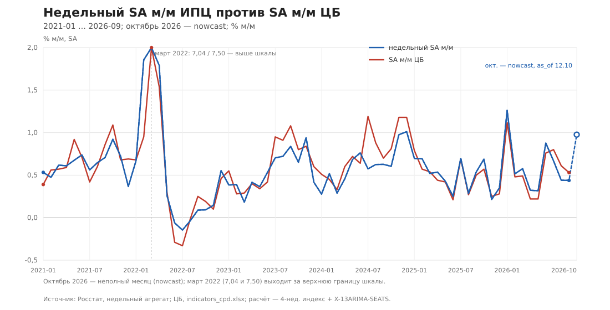

# 16,1% или 16,2%: как я построил недельный SA м/м ИПЦ

В 2024 году на smart-lab спросили: как ЦБ превращает сезонно сглаженный месячный прирост цен 1,2611% в 16,1% годовых? По формуле получается 16,23%, и вопрос повис.[^smartlab] Ответ оказался не в формуле, а в выпусках: 16,1% — это 16,07% из одного выпуска, а 1,2611% — из другого; ЦБ ревизует сезонно сглаженный ряд. И ещё важное: ЦБ не считает ИПЦ заново. Он берёт те же месячные цифры Росстата — файл `ipc_mes_09-2026.xlsx` — и применяет к ним сезонную корректировку. Поэтому 1,2611% — это SA-версия месячного ряда Росстата (точнее, агрегат сезонно сглаженных компонент), а 16,1% — её годовой пересчёт. В текущем выпуске 1,19% SA м/м дают 15,25% годовых, и ровно столько же публикует ЦБ — 15,2484%.

Но главное не это. Из-за той истории я построил недельный SA м/м ИПЦ: он обновляется каждую неделю, а не 14-го числа следующего месяца, и с 2021 года коррелирует с SA м/м ЦБ на 0,98 при средней ошибке 0,14 п.п. в месяц. Ниже — как он устроен, что показала проверка и чего он не умеет.

▪️ **Вопрос, который повис**

Вопрос был простой. ЦБ публикует месячный прирост потребительских цен с поправкой на сезонность: в июле 2024 года — 1,26113445075654%. И тот же рост в годовом выражении — 16,1%. По какой формуле одно превращается в другое?

Я посчитал: `(1 + 1,26113445075654/100)^12 − 1 = 16,23%`. Не 16,1%. Разница — 0,1 п.п., вроде мелочь. Но если на этом ряду строится решение по ставке, мелочь неприятная: непонятно, какому числу верить.

Автор вопроса написал в ЦБ и получил ссылку на те же данные. Формально ЦБ прав: данные — первоисточник. Но формула всё равно не сходилась.

▪️ **Ответ: формула верна, но числа из разных выпусков**

Я полез в архив выпусков ЦБ. В выпуске 24-06 от 3 сентября 2024 года годовой темп SA м/м за июль 2024 — 16,07%, то есть 16,1% при округлении. В следующем выпуске, 24-07 от 15 октября, — уже 16,19%. А в текущем, 26-07 от 14 октября 2026 года, — 15,2484%.[^dip]

Параллельно ревизуется и сам SA м/м. В текущем файле `indicators_cpd.xlsx` за июль 2024 стоит 1,19%, а не 1,2611%.[^cbrfile] И вот тут всё сходится: `(1 + 1,19/100)^12 − 1 = 15,25%`, а ЦБ публикует 15,2484% — разница 0,004 п.п.

| Что | Значение |
|---|---:|
| SA м/м из вопроса | 1,2611% |
| Годовой темп по формуле | 16,23% |
| Годовой темп ЦБ, выпуск 24-06 (03.09.2024) | 16,07% (≈16,1%) |
| Годовой темп ЦБ, выпуск 24-07 (15.10.2024) | 16,19% |
| SA м/м в текущем файле | 1,19% |
| Годовой темп по формуле | 15,25% |
| Годовой темп ЦБ, текущий выпуск 26-07 | 15,2484% |

Вывод: формула `((1 + SA м/м / 100)^12 − 1) × 100` верна. Но она работает только внутри одного выпуска. 16,1% и 1,2611% — из разных выпусков; ЦБ ревизует и SA м/м, и годовой темп. На всей истории с 2014 года формула воспроизводит опубликованный годовой темп со средней ошибкой 0,12 п.п. (153 месяца, корреляция 0,9999), но в отдельных месяцах расхождение доходит до 1,2 п.п. — у ЦБ своя модель сезонной корректировки, и это не тождество, а хорошая аппроксимация.

Это, кстати, ответ и на исходный вопрос: 16,1% — не ошибка формулы и не ошибка ЦБ. Это два числа из разных выпусков, между которыми прошла ревизия. Если сравнивать, берите оба числа из одного выпуска.

▪️ **Зачем считать самому**

Месячный SA м/м ЦБ выходит около 14-го числа следующего месяца. Недельные данные Росстата — каждую неделю. Между последней неделей месяца и публикацией ЦБ проходит две-три недели, а в октябре 2026 года недельный агрегат за 12 октября уже был, а сентябрьский SA м/м ЦБ вышел только 14 октября. Для решения по ставке это окно слишком большое.

Плюс сам SA-ряд ЦБ ревизуется: если ждать «окончательную» цифру, можно ждать бесконечно. Поэтому я решил считать свой месячный SA м/м по недельным данным — с явной датой, на которую он посчитан.

▪️ **Как устроена месячная SA на данных Росстата**

ЦБ не считает ИПЦ заново. Он берёт те же месячные индексы, которые публикует Росстат: в файле `ipc_mes_09-2026.xlsx`, лист 01, строка «к концу предыдущего месяца». За сентябрь 2026 года там 100,35 — то есть +0,35% к августу. Это сырой, нескорректированный ряд.[^rosstat]

Дальше ЦБ применяет свою методику. Она устроена не так, как у нас: ЦБ корректирует не сам агрегат, а отдельные компоненты ИПЦ — продовольствие, непродовольственные товары, услуги и более мелкие группы, — а затем собирает их с весами потребительских расходов. Это непрямой подход: сначала сезонная корректировка компонент, потом агрегирование. Метод — X13-ARIMA-SEATS; данные — с января 2002 года; по каждой компоненте своя спецификация, свой набор выбросов и своя модель ARIMA. Тарифы на ЖКУ и железнодорожные билеты ЦБ корректирует вручную: годовая индексация известна из постановлений, и SEATS плохо ловит её автоматически.[^method_cbr]

Результат — SA м/м в `indicators_cpd.xlsx`: за сентябрь 2026 года +0,53%. Разница с сырым Росстатом (+0,35%) — это и есть сезонная корректировка: 100,35 / 100,53 ≈ 0,9982, агрегатный сезонный фактор сентября.

Наш недельный ряд устроен иначе: мы корректируем один агрегат, а не компоненты, и делаем это на 4-недельном индексе, а не на календарном месяце. Поэтому полного совпадения с ЦБ быть не может — и не должно. Сравнивать надо SA с SA: наш недельный SA м/м с SA м/м ЦБ, а не с сырым +0,35% Росстата.

| Сентябрь 2026 | м/м | Годовой темп |
|---|---:|---:|
| Росстат, NSA | +0,35% | — |
| ЦБ, SA | +0,53% | 6,55% (из 0,53%) |
| Недельный SA | +0,438% | 5,85% (из 0,438%) |

▪️ **Как устроен недельный SA м/м**

Источник — официальный недельный агрегат «Индекс потребительских цен (недельная оценка)». До 2022 года он живёт в бюллетенях «Оперативной информации» (2009–2021), с 2019-го — в открытом BI Росстата; на пересечении приоритет у BI. Всего 760 точек с 6 апреля 2009 по 12 октября 2026.[^weekly]

Дальше — шесть шагов.

Публикации выходят не строго по календарю: 51 дата в году, праздничные пропуски, иногда 14-дневный разрыв. Поэтому я строю регулярную 7-дневную сетку: кумулятивный лог-уровень и линейная интерполяция между публикациями. Это не добавляет данных, но убирает календарный шум.

На сетке считаю 4-недельный индекс: `I_t = exp(L_t − L_{t−4}) × 100`. Это ровно 28 дней — месячный аналог SA м/м, только окно фиксированное.

Беру последнюю точку каждого месяца. Получается 209 полных месяцев с мая 2009 по сентябрь 2026. Текущий неполный месяц не выбрасываю: он идёт отдельной строкой оценки с датой последней доступной недели.

На месячной сетке запускаю X-13ARIMA-SEATS: логарифм, календарный тест, автоматические выбросы, `seats`.[^method] На недельной частоте X-13 не запускается — `Seasonal period too large`: 52 недели не образуют регулярный сезонный цикл с праздниками и тарифными неделями. Месячная сетка — правильная частота.

SA-темп за 4 недели — это `(I_SA/100 − 1) × 100`. Он и сравнивается с SA м/м ЦБ.

Годовой темп — только пересчёт: `((I_SA/100)^13 − 1) × 100`. Тринадцать четырёхнедельных окон в году; это не отдельный ряд и не новая информация.

Почему 13, а не 12: окно — 28 дней, а не календарный месяц; в году 13 таких окон. Поэтому годовой темп недельного ряда и годовой темп месячного SA м/м ЦБ — почти одно и то же, но не тождество.

▪️ **Что показала проверка**

Сравнение — в м/м, а не в годовом выражении. Так ошибка не раздувается в 12 раз и видно, насколько ряд совпадает с ЦБ по существу.

| Период | n | корреляция | средняя ошибка, п.п. | средняя разница, п.п. |
|---|---:|---:|---:|---:|
| 2009–2013 | 56 | 0,639 | 0,258 | −0,235 |
| 2014–2018 | 60 | 0,813 | 0,213 | −0,148 |
| 2019–2020 | 24 | 0,925 | 0,062 | −0,009 |
| 2021+ | 69 | **0,977** | **0,136** | −0,025 |
| Вся история 2009-05 … 2026-09 | 209 | 0,913 | 0,182 | −0,115 |

*Рис. 1. Недельный SA м/м против SA м/м ЦБ, 2021-01 … 2026-09; октябрь 2026 — оценка неполного месяца на 12.10.2026. Источник: Росстат, недельный агрегат; ЦБ, indicators_cpd.xlsx; расчёт — 4-нед. индекс + X-13ARIMA-SEATS.*

С 2021 года корреляция 0,977, средняя ошибка 0,136 п.п. в месяц, средняя разница −0,025 п.п. — то есть почти без смещения.[^corr] В годовом выражении та же связь выглядит как 0,987 и 1,84 п.п.: годовой темп просто умножает месячную ошибку примерно на 12, и не надо пугаться, что 1,84 много — в месяц это 0,14.

До 2019 года связь слабее: 0,64 в 2009–2013 и 0,81 в 2014–2018. Это не про метод, а про источник: до 2019 года недельный агрегат собран из бюллетеней с 24–51 датой в год, и сетка интерполирована. С 2019-го, когда появился регулярный BI, корреляция 0,93, а с 2021-го — 0,98.

Формальную проверку «X-13 лучше сырой 4-недельной средней» я делал на базовом ИПЦ, а не на общем.[^research] На длинной истории 2012-07 … 2026-09 X-13 даёт среднюю ошибку 2,67 п.п. в годовом выражении против 3,52 у сырой средней, различие значимо (p = 0,0216); на 2019+ — 2,42 против 3,72, p = 0,0433. На 2022+ alone значимости нет: 3,04 против 4,45, p = 0,1896. Это ограничение, а не отмена результата.

На общем ИПЦ картина другая: X-13 даёт 3,02 п.п. против 1,90 у сырой средней (p = 0,0225 — значимо хуже). Поэтому я не говорю, что SA-агрегат точнее на общем ИПЦ. Он нужен для другого: чтобы получить сезонно сглаженный месячный ряд, сопоставимый с SA м/м ЦБ, и обновлять его каждую неделю. На базовом ИПЦ на длинной истории он выигрывает значимо; на общем — нет, и это надо сказать прямо.

▪️ **Что это даёт сейчас**

Сентябрь 2026: недельный SA м/м 0,438% против 0,53% у ЦБ (сырой Росстат — 0,35%); в годовом выражении 5,85% против 6,55%. Август: 0,440% против 0,61% (5,87% против 7,57%). Июль: 0,667% против 0,80% (9,03% против 10,03%). Недельная оценка за сентябрь была доступна до публикации ЦБ 14 октября; в августе — примерно на две недели раньше.

Октябрь — отдельный разговор. Оценка на 12 октября: 0,976% SA м/м, 13,47% в годовом выражении.[^estimate] Но в неделю 5 октября агрегат прибавил 0,96% — это тарифная неделя. Одна неделя в 4-недельном окне и неполный месяц дают завышенную оценку; 13,47% — не «базовая» инфляция и не сигнал на ставку. Следующие недели покажут, сколько из этого останется. Для сравнения: в октябре 2025 года было 9,33%, в октябре 2024-го — 8,14% в годовом выражении; октябрьские всплески в ряду регулярны.

▪️ **Чего метод не умеет**

На 2022+ alone формальный критерий не выполняется (p = 0,1896). На длинной истории — выполняется, но это не то же самое, что «работает в текущем режиме».

2009–2018 — бюллетени с 24–51 датой в год и интерполяция; это не полноценная недельная история.

У недельного источника нет истории публикаций: если Росстат задним числом поправит ряд, я не увижу, как это выглядело в момент публикации.

ЦБ ревизует SA-ряд; сравнение с «финальной» цифрой — движущаяся цель.

Наш SA — прямой: мы корректируем один агрегат, а ЦБ — компоненты с весами. Поэтому SA ЦБ один в один не воспроизводится, и расхождение 0,14 п.п. в месяц — это в том числе разница конструкций.

Оценка неполного месяца пересчитывается каждую неделю и не является прогнозом месячного принта.

Недельный агрегат — не официальный SA; это производный ряд.

Корреляция 0,98 — не причинность и не гарантия, что октябрьская оценка подтвердится.

▪️ **Что дальше**

Годовой темп недельного ряда стоит на графике рядом с базовым SA м/м ЦБ. Следующий шаг — проверить октябрь и ноябрь на полных месяцах и понять, добавляет ли недельный SA м/м что-то к сырой недельной медиане для решения по ставке. Если нет — так и скажу.

---

**Ссылки и код**

- Вопрос на smart-lab: [«Как посчитать ИПЦ с поправкой на сезонность в годовом выражении?»](https://smart-lab.ru/blog/1072623.php)
- Месячный ИПЦ Росстата: [ipc_mes_09-2026.xlsx](https://rosstat.gov.ru/storage/mediabank/ipc_mes_09-2026.xlsx)
- Файл ЦБ с SA-рядом: [indicators_cpd.xlsx](https://www.cbr.ru/Content/Document/File/108632/indicators_cpd.xlsx)
- Методика SA ЦБ: [meth_cpi.pdf](https://www.cbr.ru/Content/Document/File/108630/meth_cpi.pdf), [спецификации 2026](https://www.cbr.ru/Content/Document/File/123575/Annex_2026.pdf)
- Разбор, код и данные: issue [#348](https://github.com/kmlebedev/clickhouse-import-rosstat/issues/348), PR [#350](https://github.com/kmlebedev/clickhouse-import-rosstat/pull/350), пакет `weeklysa/`, отчёт `docs/research/2026-10-22-weekly-core-proxy.md`.
- График: `docs/publications/2026-10-22-weekly-sa-cpi/weekly-sa-mm-vs-cbr.svg`.

*Не инвестиционная рекомендация. Все числа — на 22.10.2026; октябрь 2026 — неполный месяц, оценка на 12.10.2026.*

[^smartlab]: smart-lab, 2024: вопрос о том, как из SA м/м 1,26113445075654% получается 16,1% годовых; в тексте — те же числа. URL: https://smart-lab.ru/blog/1072623.php.

[^cbrfile]: ЦБ, `indicators_cpd.xlsx`, лист «Лист1», строка «Все товары и услуги»; значения на 22.10.2026: июль 2024 — 1,19% SA м/м, сентябрь 2026 — 0,53%.

[^dip]: ЦБ, приложение к бюллетеню «О чём говорят тренды», выпуски 24-06 (03.09.2024), 24-07 (15.10.2024), 26-07 (14.10.2026); ряд годового темпа SA м/м.

[^rosstat]: Росстат, `ipc_mes_09-2026.xlsx`, лист 01, строка «к концу предыдущего месяца»; сентябрь 2026 — 100,35 (+0,35% к августу). URL: https://rosstat.gov.ru/storage/mediabank/ipc_mes_09-2026.xlsx.

[^method_cbr]: ЦБ, «Методика сезонной корректировки ИПЦ Банка России» (март 2020): непрямой подход, X13-ARIMA-SEATS, компоненты с января 2002 г., ручная корректировка тарифов ЖКУ и ж/д; «Спецификации сезонной корректировки ИПЦ (2026 г.)» (февраль 2026). URL: https://www.cbr.ru/Content/Document/File/108630/meth_cpi.pdf ; https://www.cbr.ru/Content/Document/File/123575/Annex_2026.pdf.

[^weekly]: Росстат, недельный агрегат «Индекс потребительских цен (недельная оценка)»: 760 точек 2009-04-06 … 2026-10-12; 2026-10-05 — 100,96.

[^method]: Расчёт: 7-дневная сетка, 4-нед. индекс 28 дней, X-13ARIMA-SEATS `seats_log_cal`; 209 полных месяцев + оценка текущего месяца на 2026-10-12.

[^corr]: Расчёт по 69 месяцам 2021-01 … 2026-09: корреляция 0,977, средняя ошибка 0,136 п.п., средняя разница −0,025 п.п.; вся история 209 месяцев — 0,913/0,182; годовой эквивалент 2021+ — 0,987/1,84.

[^research]: `docs/research/2026-10-22-weekly-core-proxy.md` §5.7; as-of 2012-07+ 2,67 против 3,52, p=0,0216; 2022+ 3,04 против 4,45, p=0,1896; общий ИПЦ 2022+ 3,02 против 1,90, p=0,0225.

[^estimate]: Недельный SA-агрегат, октябрь 2026 — неполный месяц; последняя доступная неделя — 12.10.2026; 0,976% SA м/м, 13,47% годовых.
